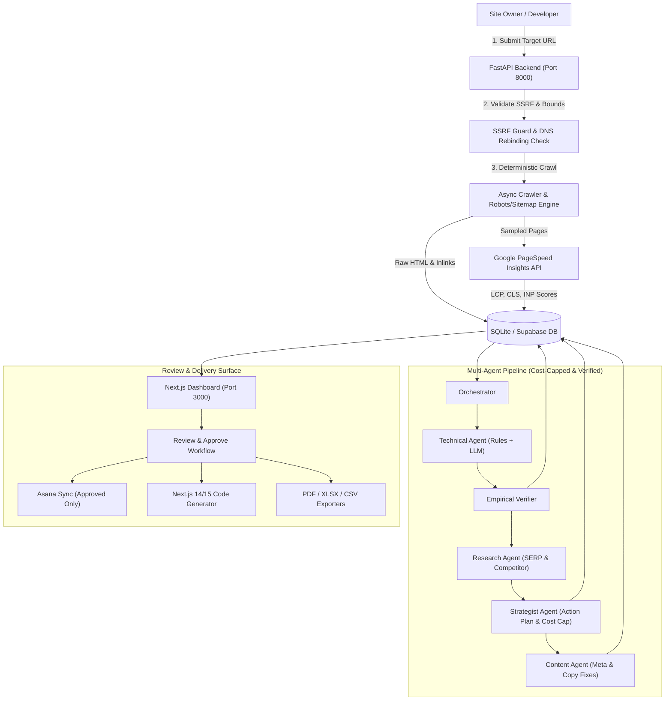

# SEO Agent Team (Autonomous Multi-Agent SEO Engineering Platform)

An autonomous multi-agent SEO engineering platform where **deterministic code collects verified empirical data, specialized agents reason over that verified data, verifiers eliminate hallucinations, and code fixes are generated with full provenance.**

---

## 1. System Architecture



---

## 2. Agent Team & Responsibilities

| Agent / Component | Execution Mode | Responsibility | Failure & Fallback Policy |
| :--- | :--- | :--- | :--- |
| **Crawler Engine** | Deterministic Python | Asynchronous crawl (up to 200 pages safety cap), sitemap vs crawl delta detection, HTML parsing. | Hard 15s timeout per request, 1 retry, graceful partial save. |
| **SSRF Guard** | Deterministic Python | Blocks RFC-1918, CGNAT, cloud metadata, numeric IPs, userinfo; prevents DNS rebinding at connect time. | Immediate rejection with `SSRFSecurityError` (HTTP 400/403). |
| **Technical Agent** | Rule Engine + Gemini 3.5 Flash | Discovers broken canonicals, meta length violations, sitemap discrepancies, mobile CWV regressions. | Fallback rule engine runs automatically if cost cap reached or API fails. |
| **Empirical Verifier** | Deterministic Python | Audits every issue claim against raw crawled HTML; rejects unsubstantiated issue claims. | Discards unverified LLM issues before they reach the user. |
| **Research Agent** | Deterministic + Gemini | Extracts competitor on-page schemas, heading hierarchy, and target keyword density. | Polite crawl with 1.0s delay; falls back to on-page heuristics. |
| **Strategist Agent** | Deterministic + Gemini | Prioritizes tasks into High/Medium/Low sprints with estimated developer effort. | Sequential task numbering (`T-001`, `T-002`) with deterministic rule fallback. |
| **Content Agent** | Deterministic + Gemini | Rewrites titles (&le; 60 chars) and meta descriptions (&le; 155 chars) maintaining brand voice. | Length bounds enforced; falls back to template metadata if bounds exceeded. |
| **Code Fix Generator** | Deterministic AST + Template | Generates drop-in `app/sitemap.ts`, `app/robots.ts`, `next.config.js`, and route snippets. | Next.js 14 vs 15+ version selector toggles dynamic route `params` typing. |

---

## 3. Verified Real-World Sample Outputs (Point-in-Time Snapshot)

> [!NOTE]
> **Snapshot Date:** November 8, 2026  
> **Target URL:** `https://webspire-agency.vercel.app/`  
> **Benchmark Jobs:**  
> - **Job `78ecbb30` (Full Pipeline Run):** Crawled 28 URLs total (27 returning HTTP 200, 1 returning HTTP 404). Detected 7 stale sitemap URLs and 9 missing indexable pages.  
> - **Job `8aac96bd` (Cancel/Resume Run):** Crawled 15 URLs (all 15 returning HTTP 200; job was cancelled during PageSpeed and resumed).  
> **Page Count Variance:** For any variance in total crawled URLs across distinct crawl runs (15 vs 26 vs 28), where differences cannot be established definitively from crawler logs: **cause not determined**. All metrics below represent empirical point-in-time snapshots.

- **Status of `/portfolio/iron-pulse-fitness`**:
  - **Live Inlinks:** Confirmed linked on live pages: `/` (Anchor: `'View Live Project'`), `/portfolio` (Anchor: `'View Live Project'`), and `/portfolio/ironpulse-fitness` (Anchors: `'View Live Project'`, `'Visit Live'`, `'Open Live Site'`).
  - **Sitemap Presence:** Confirmed present in live `sitemap.xml`, returning **HTTP 404 Not Found** on live probe.
- **Sitemap Discrepancy Breakdown (from Job `78ecbb30` Snapshot)**:
  - **7 Stale Sitemap URLs Detected**: Returned 404 on live probe or not crawlable (e.g. `/blog/nextjs-14-seo-best-practices`, `/portfolio/iron-pulse-fitness`, `/services/ai-automation`, `/services/ai-search-optimization`).
  - **9 Missing Indexable Pages Detected**: Crawled with status 200, self-canonical, but absent from `sitemap.xml`.
- **Pipeline Execution Cost**: `$0.002036` (strictly within the `$0.25` per-job cap and `$2.00` daily cap).
- **Generated Drop-In Code**:
  - `app/sitemap.ts` includes canonical fixes with post-fix notes.
  - Root layout title shortened to &le; 60 characters: `"WebSpire | Pakistan's Trusted Digital & Web Agency"`.
  - Rewrite meta description trimmed from 178 characters to &le; 155 characters.
  - `llms.txt` generated conforming to specification with full URLs.

---

## 4. Asana Export & CSV Import Mapping Guide

The platform provides two export options for task handoff to developers: direct Asana API sync and an **interactive CSV Mapping Guide** compatible with both **Free and Paid Asana workspaces**:

### How to Import the CSV into Asana:
1. Export the approved strategy tasks by clicking **Download asana_import.csv** in the Asana modal.
2. In Asana, select your team project &rarr; click the project header dropdown &rarr; **Import &rarr; CSV**.
3. Select `asana_import.csv`. Asana's importer will open the column mapping screen.
4. **Column Mapping Guide**:
   - `Name` &rarr; Map to **Task Name**
   - `Description` &rarr; Map to **Description**
   - `Due Date` &rarr; Map to **Due Date** (automatically formatted as `MM/DD/YYYY`)
   - `Start Date` &rarr; Map to **Start Date** (`MM/DD/YYYY`)
   - `Dependencies` &rarr; Map to **Dependencies**
5. **Section Recognition**: Section header rows end with a colon (e.g. `Week 1:`, `Week 2:`). Asana's CSV importer automatically recognizes these as Section headers and groups subsequent tasks into their respective milestone sprints.
6. **Free-Tier Compatibility**: Free Asana plans do not support paid Custom Fields. To ensure 100% feature parity, Task IDs (`T-001`), Impact levels, Effort estimates, Done When acceptance criteria, source issue IDs, and affected URLs are consolidated into the task `Description`. Assignee is left blank by default because the importer requires the exact work email of a member in that workspace.

---

## 5. Demo Mode

The platform includes a dedicated demonstration mode with synthetic mock data for onboarding and testing without consuming live crawl or LLM quota:
- **Explicit Watermarking**: All Demo Mode audits prominently display the **`[DEMO DATA]`** watermark banner in the Web Dashboard, PDF reports, Excel spreadsheets, and CSV exports.
- **Zero Real-Client Misrepresentation**: Demo data is never intermingled with real audits.
- **Production Guard**: When `ENVIRONMENT=production`, demo data seeding is strictly disabled.

---

## 6. Localhost Operations

Per security policy, this application runs entirely on `localhost`:

```powershell
# Terminal 1: FastAPI Backend
.\start-backend.bat

# Terminal 2: Next.js Frontend
.\start-frontend.bat
```

For detailed deployment parameters, containerization, and production secret requirements, see [DEPLOY.md](docs/DEPLOY.md).

---

## 7. Accuracy & Hardening Engine (Audit Gate)

The platform includes rigorous accuracy gates and generic platform adapters:
- **Zero Hallucination Verifier:** Every finding, rewrite, and strategy task requires empirical evidence before inclusion in deliverables.
- **Generic CMS Architecture:** Automatic framework detection with tailored adapters for **WordPress / Elementor**, **Next.js**, **Shopify**, and standard HTML sites.
- **Exact Core Web Vitals:** Strict 3-band CWV standards (Good, Needs Improvement, Poor) with Lighthouse lab-data validation.
- **Deterministic 4-Week Strategy:** Fallback plan builder that guarantees a prioritized, phased 30-day roadmap even when external APIs (GSC, SERP) are unlinked.
- **Report QA Gate:** Automated pre-export linter that checks metric plausibility, URL reproduction evidence, and contiguous report layout.

